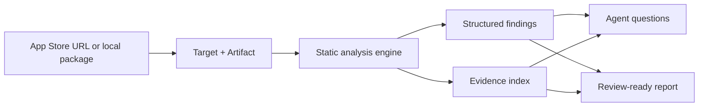

<p align="center">
  <picture>
    <source media="(prefers-color-scheme: dark)" srcset="assets/brand/banner-dark.svg">
    
  </picture>
</p>

<p align="center">
  <a href="https://github.com/zhuixin-labs/app-evidence/blob/main/LICENSE"></a>
  <a href="https://github.com/zhuixin-labs/app-evidence/actions/workflows/ci.yml"></a>
  
  
  
</p>

<p align="center">
  <strong>Turn an authorized app package into evidence your coding agent can actually use.</strong>
</p>

<p align="center">
  AppTrace connects app acquisition, static analysis, structured findings, evidence, and reports to MCP-compatible agents.
</p>

---

## Why AppTrace

Most reverse-engineering tools stop at a binary, a decompiler, or a folder full of JSON.

AppTrace produces a reviewable analysis surface:

- **Technology and feature map** — frameworks, routes, modules, assets, storage, and network candidates.
- **Evidence-backed findings** — every important result carries a source location and Evidence ID.
- **Agent-ready tools** — analyze, search, inspect, compare, and report through MCP.
- **Local-first execution** — app packages and Apple credentials stay on your machine.
- **Explicit uncertainty** — encrypted code, incomplete coverage, and static-analysis limits are reported instead of hidden.

## What it looks like

```text
Target     车工计算器
Artifact   IPA · 18.7 MB · SHA-256 verified
Tech       uni-app / HBuilder
Routes     195
Modules    17
Native     1,485 procedures · 6,203 strings
Protection cryptid=1 · native decompilation blocked
Report     targets/.../reports/<job-id>.md
```

A typical agent session can continue with:

```text
Which routes are related to threading?
Find native symbols related to “main”.
Compare the last two analyzed versions.
Generate a report with evidence and limitations.
```

## How it works



## Core capabilities

| Capability | What it gives you |
| --- | --- |
| Analyze application | Technology hints, routes, modules, assets, storage, and limitations |
| Inspect native code | Architecture, symbols, strings, and encryption state |
| Search findings | Query routes, modules, artifacts, and native procedures |
| Compare versions | Added, removed, and unchanged routes, modules, assets, and endpoints |
| Generate report | A Markdown deliverable tied to Evidence IDs |
| Run through MCP | Let Codex, Claude, Cursor, or another MCP client orchestrate the workflow |

## Quick start

> **Preview:** package publication is in progress. The source preview below uses the
> public Open Core packages; the commercial analysis engine is distributed separately.

The public repository contains the integration layer. Analysis commands require a
separately distributed engine build or preview access.

```bash
git clone git@github.com:zhuixin-labs/app-evidence.git
cd app-evidence
pnpm install
pnpm build

node packages/cli/dist/index.js setup
node packages/cli/dist/index.js auth login
node packages/cli/dist/index.js analyze \
  https://apps.apple.com/cn/app/id1616124777 \
  --goals tech_stack,feature_map,report
```

Generate an MCP configuration:

```bash
node packages/cli/dist/index.js setup --write-config ./.codex/config.toml
```

See [Getting started](docs/getting-started.md) for the full first-run flow.

## MCP-native

Once configured, an agent can use:

```text
analyze_app
get_analysis_run
search_findings
search_native
decompile_function
compare_versions
generate_report
list_evidence
```

AppTrace returns compact, structured results by default. Large semantic graphs remain in
local Evidence files and are read only when needed.

See [MCP setup](docs/mcp.md) for client configuration and tool details.

## Built for real analysis work

- **Competitive teardown** — understand the technology stack, page map, and product surface.
- **Release audit** — compare versions and detect routes, assets, and native changes.
- **Migration research** — identify frameworks, modules, and integration boundaries.
- **Agent-assisted investigation** — continue from a summary into focused evidence searches.

## Security and authorization

AppTrace is intended for applications you own or are authorized to analyze.

- Apple passwords, 2FA codes, cookies, and keychain passphrases never enter the agent context.
- The target application is not executed.
- Encrypted regions are identified explicitly and are not treated as trustworthy decompilation.
- Analysis is local by default; app packages are not uploaded to an AppTrace service.

Read [Security](SECURITY.md) before analyzing a third-party package.

## Open Core

The integration layer is open source under Apache-2.0:

- MCP server and CLI
- Engine protocol and client
- Metadata, Target, Artifact, Job, and Evidence models
- Agent Skill

The commercial analysis engine, advanced report packs, and team capabilities are
distributed separately. This keeps the public integration surface open while preserving
the core analysis product.

## Documentation

- [Getting started](docs/getting-started.md)
- [MCP setup](docs/mcp.md)
- [Architecture](docs/architecture.md)
- [Security](SECURITY.md)
- [Windows verification](docs/windows-verification.md)
- [Contributing](CONTRIBUTING.md)

## Status

AppTrace is in preview. The core analysis loop is working on macOS; Windows host
validation and the Windows Target Provider are the next platform milestones.

## License

Public integration packages are licensed under [Apache-2.0](LICENSE). The private
analysis engine has a separate commercial license.

---

<p align="center">
  <sub>Built for developers who want answers, not just artifacts.</sub>
</p>
