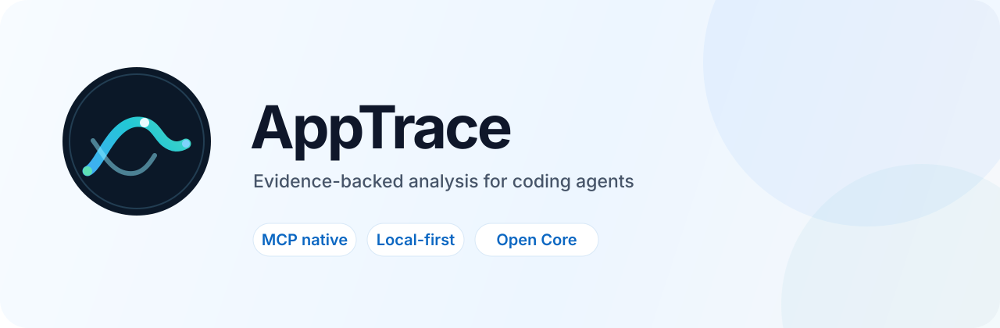
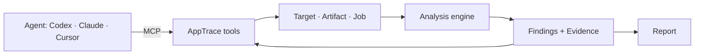

<p align="center">
  <picture>
    <source media="(prefers-color-scheme: dark)" srcset="assets/brand/banner-dark.svg">
    
  </picture>
</p>

<p align="center">
  <a href="https://github.com/zhuixin-labs/app-evidence/blob/main/LICENSE"></a>
  <a href="https://github.com/zhuixin-labs/app-evidence/actions/workflows/ci.yml"></a>
  
  
  
</p>

<p align="center">
  <strong>Your coding agent can't read an App Store app. AppTrace fixes that.</strong>
</p>

<p align="center">
  Point Codex, Claude, or Cursor at an App Store link. It downloads the IPA, maps the routes,
  modules and endpoints, searches the native symbols, and hands back a report with evidence.
</p>

---

## The problem

Your agent is great at reading a repository. An App Store app has no repository.

What it has is a signed bundle: minified JavaScript, a Mach-O binary, a plist, and no
entry point for your agent to start from. So "how does this competitor do login?" turns
into an afternoon of unpacking, grepping, and pasting JSON into a chat window.

AppTrace turns that bundle into something an agent can search, cite, and reason over —
through MCP, in the client you already use.

## What it looks like

```text
You     Tear down https://apps.apple.com/cn/app/id1616124777

Agent   ✓ resolved        车工计算器
        ✓ downloaded IPA  18.7 MB · sha256 verified
        ✓ stack           uni-app / HBuilder
        ✓ surface         195 routes · 17 modules
        ✓ native          1,485 procedures · 6,203 strings
        ⚠ limitation      cryptid=1 · native decompilation blocked
        → report          targets/.../report.md · 42 evidence links
```

From there you keep asking, in the same conversation, and the agent answers from the
evidence instead of guessing.

## Get started

**1 · Install**

```bash
npm install -g @zhuixin/cli
```

**2 · Get the engine**

The analysis engine is what turns a bundle into findings, and it is licensed separately
from this repository. During the preview it is distributed as a single file.

[Request preview access](https://github.com/zhuixin-labs/app-evidence/issues/new?title=Engine%20access%20request&body=Which%20apps%20are%20you%20planning%20to%20analyze%3F) —
you will receive `engine-main.js` and its SHA-256.

**3 · Prepare the machine once**

```bash
apptrace engine install ./engine-main.js --sha256 <sha256>
apptrace auth login
```

`engine install` verifies the hash and puts the engine in your local workspace.
`auth login` signs in to your Apple account so AppTrace can download apps you own — it
uses [ipatool](https://github.com/majd/ipatool) and sends the 2FA prompt to your device.
Both are one-time; run `apptrace setup` at any point for a readiness check.

**4 · Connect your agent**

One command per client. The only difference is where that client reads its config.

| Client | Command |
| --- | --- |
| Codex | `apptrace setup --write-config ~/.codex/config.toml` |
| Claude Code | `apptrace setup --write-config .mcp.json` |
| Cursor | `apptrace setup --write-config .cursor/mcp.json` |
| Claude Desktop (macOS) | `apptrace setup --write-config "$HOME/Library/Application Support/Claude/claude_desktop_config.json"` |
| Claude Desktop (Windows) | `apptrace setup --write-config "%APPDATA%\Claude\claude_desktop_config.json"` |

Restart the client, or open a new conversation, so it picks up the server. Ask for the
tool list — `/mcp` in Claude Code — and you should see twelve AppTrace tools.

Anything that speaks MCP over stdio works the same way: the generated file is a standard
`mcpServers` entry for JSON clients and `[mcp_servers.apptrace]` for TOML clients.

**5 · Stop typing commands**

This is the part that matters:

- *Tear down this app and tell me how it makes money.*
- *How does the login flow work? Show me the endpoints it calls.*
- *Compare the last two versions of this app. What changed?*
- *Turn that into a one-page brief for my product team.*

The agent decides which tools to call, waits for long jobs, narrows into evidence when a
summary is not enough, and writes the report.

## What the agent can do

| Tool | What it is for |
| --- | --- |
| `analyze_app` | Resolve a store link, download, inspect, and analyze it |
| `get_analysis_run` | Follow or wait on a running analysis |
| `list_targets` | See every app already analyzed locally |
| `search_findings` | Search routes, modules, assets, endpoints |
| `search_native` | Search native procedures and strings |
| `decompile_function` | Decompile one exact symbol found by search |
| `compare_versions` | Diff two analyzed versions |
| `generate_report` | Produce a Markdown report with evidence links |
| `list_evidence` | List the evidence behind a target |
| `get_job` | Inspect a job and its events |
| `auth_status` | Check Apple sign-in state, without exposing credentials |
| `list_capabilities` | See what is possible for the current target |

Results come back compact. Full semantic graphs stay in the local workspace and are
referenced by Evidence ID, so a long analysis does not flood the context window.

## What you actually get

- **A searchable feature map** — framework, routes, modules, assets, storage, network candidates.
- **Native ground truth** — architectures, symbols, strings, encryption state.
- **Version deltas** — what was added, removed, or changed between two builds.
- **A reviewable report** — Markdown, with every claim tied to a source location.

No screen recording, no manual tapping, no "trust me" summaries.

## CLI for humans

The same engine without an agent in the middle:

```bash
apptrace analyze https://apps.apple.com/cn/app/id1616124777 --goals tech_stack,feature_map,report
apptrace targets list
apptrace search <target-id> login
apptrace compare <target-id> <left-artifact> <right-artifact>
apptrace report <target-id>
```

Useful for CI and batch work; the agent path is usually faster for exploration.

## How it works



App packages, Apple credentials, and analysis output stay on your machine. Nothing is
uploaded to an AppTrace service, and the target app is never executed.

## What's included

| | Free | Pro |
| --- | --- | --- |
| IPA inspection, extraction, plist and Mach-O facts | ✓ | ✓ |
| JavaScript, route, module and endpoint mapping | ✓ | ✓ |
| Evidence-backed reports | ✓ | ✓ |
| Native symbol search and decompilation | — | ✓ |
| Version comparison | — | ✓ |

Native analysis and version comparison require a signed license. Ask your agent what it
can do with a target — `list_capabilities` reports exactly what your license enables.

## Supported today

- macOS arm64 hosts, App Store (iOS) targets.
- Windows hosts: toolchain bootstrap and analysis run; the Windows *target* provider
  (PE/MSIX/MSI) is on the roadmap.
- Encrypted binaries are reported as encrypted, never presented as decompiled truth.

## Security and authorization

AppTrace is for applications you own or are authorized to analyze.

- Apple passwords, 2FA codes, and keychain passphrases never enter the agent context.
- The target app is not executed; JavaScript is parsed as inert text.
- Coverage limits and encrypted regions are reported explicitly.

Read [SECURITY.md](SECURITY.md) before analyzing a third-party package.

## Open source, commercially supported

The integration layer is Apache-2.0: CLI, MCP server, engine protocol and client, the
Target/Artifact/Evidence model, and the bundled Agent Skill. The analysis engine,
advanced report packs, and team features are licensed separately.

That split is deliberate: the protocol stays open so your agent integration is portable,
while the analysis engine — the part that does the hard work — remains a product you can
depend on.

## Documentation

- [Getting started](docs/getting-started.md)
- [MCP setup and tool reference](docs/mcp.md)
- [Architecture](docs/architecture.md)
- [Security](SECURITY.md)
- [Contributing](CONTRIBUTING.md)

## License

Public integration packages: [Apache-2.0](LICENSE). The analysis engine: separate
commercial license.

---

<p align="center">
  <sub>Your agent already reads code. Give it the rest of the app.</sub>
</p>
